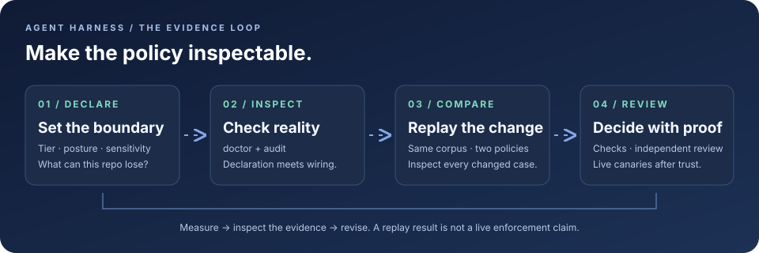

# agent-harness

The tier model, shared deny floor, and audit tools for the Codex and Claude repositories in this estate: what a repo is allowed to lose, what an argv line can prove, and whether the hook that claims to enforce it is actually wired.

[](https://github.com/Chris0Jeky/agent-harness/actions/workflows/ci.yml)
[](https://github.com/Chris0Jeky/agent-harness/actions/workflows/pages.yml)
[](https://github.com/Chris0Jeky/agent-harness/blob/main/.github/workflows/ci.yml)
[](LICENSE)

Docs site: <https://chris0jeky.github.io/agent-harness/>



## Start with a concrete question

| What you want to know | Start here |
|---|---|
| What does changing a guard actually do? | **[Open the interactive replay lab](https://chris0jeky.github.io/agent-harness/docs/POLICY_LAB.html)**: inspect recorded cases, filter decision changes and try a sample regression gate. |
| Does this repo's declared policy match reality? | `python harness.py audit . --offline` |
| Is the hook wiring inspectable? | `python harness.py doctor --repo . --offline` |
| What would a global update replace? | `python harness.py sync-global --config-root PATH/TO/claude-config` (preview) |
| Can an old worktree be removed safely? | `python harness.py worktrees --repo . --json` (read-only) |

The replay lab uses the checked-in toy-guard report: 40 synthetic cases and 10 fully re-authored historical/opaque shapes. Its candidate removes three benign blocks but also admits one destructive cleanup case. Every displayed change links back to a recorded decision. Browser controls do not execute commands or change a deployed policy.

## What it does

| Tool | Purpose | Evidence boundary |
|---|---|---|
| **Tier model** | Declare the repository's risk, authority and verification budget. | Codex and Claude share policy; runtime hook output remains explicit. |
| **Deny floor** | Inspect shell argv for the irreversible cases the parser can see. | A tripwire with [documented limits](FLOOR_LIMITATIONS.md), not a sandbox. |
| **Doctor + audit** | Check declarations against wiring, files and inspectable remote state. | `UNPROVEN` is visible; static checks do not prove runtime enforcement. |
| **Replay** | Compare two policies on the same pinned corpus and inspect changed decisions. | Replays command text through policies, never the original shell or side effects. |
| **Sync + worktree tools** | Preview installations, preserve recovery bytes and coordinate cleanup. | Installation and removal need explicit apply; ownership leases are cooperative. |
| **Learning and evidence tools** | Produce local evaluation, outcome and review reports. | Reports do not merge, deploy or promote a floor by themselves. |

The canonical dispatcher is **1.8.1 (2026-10-07)** and feature-frozen: false-positive fixes, ratified #21 slices, SPECS §6 charter repairs and owner-ratified exceptions only ([BLUEPRINT §2](BLUEPRINT.md#2-the-floor-analyzer-contract-posture-and-wiring)). New bypass families go in [`FLOOR_LIMITATIONS.md`](FLOOR_LIMITATIONS.md).

This checkout declares **T3 / workshop** and `floor_wiring: none`: push and merge are permitted behind the review gate, and no PreTool floor runs here. Enabled consumer repos still require CWD-specific runtime trust and live canaries. `legacy/` is historical source material; do not execute it.

## Quickstart

CI calls `python` on 3.11. The Windows docs use `py -3`. This tree was checked with `python3`. The scripts are the same.

```bash
python3 harness.py audit . --offline
python3 harness.py doctor
python3 harness.py doctor --repo . --offline
python3 harness.py worktrees --repo . --json
```

`audit . --offline` checks local declarations without remote lookups. Expect remote-dependent facts, such as default-branch protection, to remain `UNPROVEN`. Read the findings as well as the exit status.

`doctor` on a machine with no `codex` binary and no deployed `~/.claude/hooks` exits 1. That is the live-home axis. This repository separately declares `floor_wiring: none`, so its project check does not require a hook adapter. Supply `--config-root` when you have the `claude-config` checkout whose bytes should match the deployed global guidance.

Seed is write-once. It refuses to overwrite an existing runtime-neutral tier file. When `.gitignore` does not already cover `/.claude/worktrees/`, seed adds that line. `--dry-run` prints the declaration and the ignore plan, and writes nothing.

```bash
python3 harness.py seed PATH --tier 2 --sensitive-data --dry-run
```

Sync diffs unless you pass `--apply`. `--only` fails closed on an unknown component.

```bash
python3 harness.py sync-global --config-root PATH/TO/claude-config
python3 harness.py sync-global --config-root PATH/TO/claude-config --apply
python3 harness.py sync-global --config-root PATH/TO/claude-config --only codex-agents --only skill:route-codex-work
python3 harness.py sync-global --config-root PATH/TO/claude-config --only claude-skill:resume-repo-work
python3 harness.py sync-global --config-root PATH/TO/claude-config --only bundle:muse-runtime
python3 harness.py sync-global --config-root PATH/TO/claude-config --only bundle:muse-runtime --rollback-receipt PATH/TO/receipt.json
```

Policy Lab, without installing the package (the console script name after `pip install .` is `charter-replay`):

```bash
PYTHONPATH=. python3 -m replay_v0.cli validate --corpus replay_v0/corpora/charter
PYTHONPATH=. python3 replay_v0/app.py hooks \
  --baseline "python3 examples/toy-guard/guard_v1.py" \
  --candidate "python3 examples/toy-guard/guard_v2.py" \
  --corpus replay_v0/corpora/charter \
  --output /tmp/toy-replay \
  --jobs 1
```

The checked-in corpora are `charter-v0.1` (50 events) and `charter-v0.2` (494 events). The toy-guard example is expected to exit 1, which is its default regression gate: `summary.json` recorded `"newly-allowed": 4`. CI's `replay-package` job asserts that same count. The checked-in write-up is [`examples/toy-guard/README.md`](examples/toy-guard/README.md).

The floor example compares one dispatcher against tier-3 and tier-4 workspaces:

```bash
PYTHONPATH=. python3 replay_v0/app.py hooks \
  --baseline "python3 templates/hooks/dispatch.py --event pre --runtime claude" \
  --candidate "python3 templates/hooks/dispatch.py --event pre --runtime claude" \
  --baseline-workspace examples/floor/workspace-t3 \
  --candidate-workspace examples/floor/workspace-t4 \
  --corpus replay_v0/corpora/charter \
  --output /tmp/floor-replay \
  --fail-on newly-allowed \
  --jobs 1
```

Read the generated summary for the current dispatcher bytes. [`examples/floor/report/summary.md`](examples/floor/report/summary.md) is a historical recording, so its counts can differ from a fresh run.

Dev tools, pinned in [`requirements-dev.txt`](requirements-dev.txt):

```bash
python3 -m pip install -r requirements-dev.txt
python3 -m unittest discover -s tests -p "test_*.py" -v
python3 templates/hooks/smoke_test.py
python3 -m unittest discover -s replay_v0/tests -v
```

Ruff, Black, and `py_compile` run through `scripts/python_checks.py` with the curated `scripts/python_check_files.json` inventory. Add new checked Python modules there once; Black also scans the whole replay package.

## Contracts that bite

### Audit

`audit` compares declarations with remotes and bytes. A public push URL on a repository that declares `sensitive_data` is a `MISMATCH`. A public fetch URL behind a private push URL is an `advisory`. The owner-ratified `public_synthetic_publication` object can mark one exact remote/repository pair `ok`. Credentials in a remote URL are redacted before they reach a finding. Probes are read-only, deadline-bounded, and resolve binaries from absolute `PATH` entries. `--offline` skips network resolvers, including `git ls-remote`. A harness checkout used as the canonical floor reference must be clean on `main` and level with the published tip. A detached CI checkout cannot be that reference, so the canonical-template leg stays `UNPROVEN` there. The deployed `~/.claude/hooks` copy is an advisory for `audit`; `doctor` owns that axis.

### Doctor

`doctor --repo` walks active `.codex` layers only when every inspectable `project_root_markers` value is absent or exactly `[".git"]`. It requires one project-floor candidate, one conservative POSIX and Windows command shape, and the current normalized dispatcher marker, unless `floor_wiring` is `none`, in which case it requires the absence of a Codex floor handler and of a global Claude dispatcher. Static validation does not execute the hook. Managed-cloud, MDM, per-invocation, and plugin hooks are runtime-only. For a linked worktree, Codex maps hook layers back to the root checkout that owns the Git common directory. Trust hashes are not hand-edited.

When a PreTool floor is enabled, the supported bootstrap is the exact-CWD TUI procedure in [SPECS: Codex project-hook trust bootstrap](SPECS.md#codex-project-hook-trust-bootstrap). Linked-worktree candidate checks are in [SPECS: Candidate validation from linked worktrees](SPECS.md#candidate-validation-from-linked-worktrees). Posture rendering is [SPECS §5.4](SPECS.md#54-posture-and-floor_ack-owner-decisions-2026-09-02-and-2026-09-27-21-slices-26--62-356).

### sync-global

Dry-run is the default. `--apply` backs up changed global guidance, shared Claude-home hook bytes, managed skill folders, and reviewed `codex/agents/*.toml` files before replacing them. Stale managed Codex agents are removed only when the deployed bytes still match the last harness-managed version. Default file sync refuses aliased homes, non-regular files, and destinations with multiple hard links, then publishes through a flushed sibling and a rename.

`--only claude-skill:<name>` copies one skill from `<config-root>/skills/<name>` to `<claude-home>/skills/<name>`. `--only bundle:muse-runtime` reads schema 1 from `<config-root>/.agent-harness/sync-global.json` and deploys only the files that manifest names. Rollback is dry-run unless `--apply` is set, and it restores a component only while live and backup digests still match the receipt. Neither lane promises crash-atomic multi-file writes or exclusion of a concurrent writer. Remaining fault and platform notes are in [#278](https://github.com/Chris0Jeky/agent-harness/issues/278).

Future Codex skill backups go under `<codex-home>/backups/<timestamp>/skills/`, outside the skill root Codex scans. A backup tree that overlaps the skill home is refused. Legacy `<skills-home>/.harness-backups/` copies are left in place.

### Worktree closeout

`worktrees` does not fetch, lease, remove, prune, or delete branches unless you say so. `--refresh` fetches every configured remote. A grafts file, a replace ref, or a per-worktree `core.worktree` redirect blocks the candidate. The Git subprocess environment disables replace objects and drops an inherited `GIT_GRAFT_FILE`.

The lease is cooperative. `worktree-lease --action acquire` writes a short-lived record in that linked worktree's Git administrative directory, scoped to one physical common-Git directory and worktree path. The claimant is a self-declared session id, not an authenticated principal. Creation refuses an existing lease. The same claimant may renew or release. An expired lease is replaceable only with `acquire --replace-stale`.

`--apply` requires `--refresh`, the same `--claimant`, at least ten seconds left on the lease, and a fingerprint whose monotonic age and suspend-inclusive UTC age are both at most 60 seconds. UTC clock rollback fails closed. Apply holds the per-worktree mutation lock from the last lease check through removal. The only destructive command is plain `git worktree remove` of the canonical path. There is no `--force`, no branch deletion, and no `git worktree prune`. Dirty, ignored, mode-only (POSIX), detached, reflog, and `ORIG_HEAD` states block removal. `--json` schema version 3 carries the preservation evidence. The lease cannot see a process that ignores it.

### Floor limits

The dispatcher is an argv tripwire. It does not see `apply_patch`, Edit, Write, MCP, or a stdin-fed interpreter. Known gaps are the catalogue in [`FLOOR_LIMITATIONS.md`](FLOOR_LIMITATIONS.md). This repository does not ship a separate `SECURITY.md`. Report a floor bypass as a limitation line unless it regresses the SPECS §6 charter matrix in canonical form, which is repaired.

Changing `dispatch.py` means the smoke matrix, the harness unit tests, an independent read-only review, a `FLOOR_VERSION` bump, and a refreshed audit-only marker in [`templates/codex/hooks.json`](templates/codex/hooks.json) and in every consumer. The runtime does not verify that marker. Each enabled consumer still needs a new-session `/hooks` re-trust. This producer repo is floorless; its own Codex re-trust is not a consumer canary.

## Tech stack

| Piece | What the repo actually uses |
|---|---|
| Language | Python. CI is 3.11 on `ubuntu-latest`, `windows-latest`, and `macos-latest` ([`.github/workflows/ci.yml`](.github/workflows/ci.yml)). `requires-python` is omitted on purpose so Black does not reformat the rest of the tree to a target taken from the replay package. |
| Runtime deps | None. `harness.py`, `dispatch.py`, and `replay_v0` are stdlib. |
| Package | setuptools builds only `replay_v0` as `charter-replay`. The console entry is `replay_v0.app:main`. |
| Dev pins | `black==26.3.1`, `ruff==0.15.13`, `pytest==9.0.3`. Unittest is the CI lane. Pytest is the extra compatibility job `operations-contract`. |
| CI | Workflow `CI`: `verify`, `replay-package`, `replay-fast`, `replay-lint`, `replay-tests`, `charter-digests`, `recorded-baseline`, `operations-contract`. Actions are pinned to commit SHAs. `verify` is 30 minutes, lint first. |
| Docs | [`scripts/build_docs_site.py`](scripts/build_docs_site.py) stages an allowlist. Pages builds it with `actions/jekyll-build-pages` and checks rendered links. Pull requests build; deploy runs on `main`. |
| Fixture workflow | [`.github/workflows/bughunt-micro.yml`](.github/workflows/bughunt-micro.yml) runs only when its fixture paths change, and the job is `continue-on-error`. It is not a merge gate. |

## Status and roadmap

The version the code declares is `FLOOR_VERSION` in `templates/hooks/dispatch.py`: **1.8.1 (2026-10-07)**.

Dated write-ups lag that constant. Read them for evidence, then check the constant before you quote a deployment:

| File | Role | Snapshot it names |
|---|---|---|
| [`AGENT_HARNESS_AGENT_BRIEF.md`](AGENT_HARNESS_AGENT_BRIEF.md) | Mission: Policy Lab, Pattern Guard, Doctor, estate operations | Last reviewed 2026-07-30 |
| [`plans/ACTIVE.md`](plans/ACTIVE.md) | Declared `status_doc`. At most two active workstreams, plus later owner decisions | Source checkpoint 2026-10-13; earlier sections are historical |
| [`docs/SYSTEM_STATE.md`](docs/SYSTEM_STATE.md) | Capability ledger and evidence vocabulary | Source acceptance 2026-10-13; historical runtime records retained |
| [`ROADMAP.md`](ROADMAP.md) | Dependencies and epic map AH-1 through AH-10 | Current dependency checkpoint 2026-10-13; epic map dated 2026-08-08 |
| [`HUMAN_TODO.md`](HUMAN_TODO.md) | Human gates | Open: H-18 (private-repo Actions billing), H-19 (PyPI trusted publisher for the replay extraction), H-22 (1.8.0 consumer re-trust and canaries) |
| [`docs/BENCHMARKS.md`](docs/BENCHMARKS.md) | Measured baselines and what they do not prove | Historical B-series |
| [`docs/observability/AGENT_LOOP_SPANS.md`](docs/observability/AGENT_LOOP_SPANS.md) | Proposed span contract | No exporter, no merge gate |

H-22 records that floor **1.8.0** was vendored and that several consumer marker PRs merged, with extract-api's adapter proof still open, as of 2026-10-05. That record is about 1.8.0. It is not a runtime proof of 1.8.1. Do not describe a consumer as canaried because this source moved.

`plans/ACTIVE.md` records an owner decision (2026-09-29) that a clean public replay repository may be extracted as `charter-replay` under Apache-2.0, and that PyPI publication is H-19. This repository stays `GPL-3.0-only`. Blueprint-plugin extraction stays deferred. Public replay work does not relicense this tree.

Near-term source work that those files still name, and that the code has not closed: Doctor correctness follow-ups, bounded Pattern Guard gaps tracked from [`FLOOR_LIMITATIONS.md`](FLOOR_LIMITATIONS.md), and the human rollout in H-22. Integrated measurement beyond the scripts above is not a live gate.

## Where to read next

| File | What it is |
|---|---|
| [`BLUEPRINT.md`](BLUEPRINT.md) | Tier ladder T0–T4, principles P1–P12, regions, Gardener, model routing |
| [`SPECS.md`](SPECS.md) | `tier.json` schema, budgets, hook wiring, deny-floor matrix, Stop hooks, model routing, harness CLI, Gardener, skill-forge, concurrency and review pipeline |
| [`BOOK.md`](BOOK.md) | The rationale behind the policy and design choices |
| [`FLOOR_LIMITATIONS.md`](FLOOR_LIMITATIONS.md) | Known limits of the argv tripwire |
| [`AGENTS.md`](AGENTS.md) | Repository change rules and verification commands |

## License

The owner-authored contents of this repository are licensed under GNU General
Public License version 3 only (`GPL-3.0-only`). See [`LICENSE`](LICENSE) and
[`LICENSING.md`](LICENSING.md). The curl-derived option-arity fixture retains
curl's own licence; see [`THIRD_PARTY_NOTICES.md`](THIRD_PARTY_NOTICES.md).

This repository-level decision does not decide the licences of the possible
future clean-repository plugin or replay products described in the blueprints.
